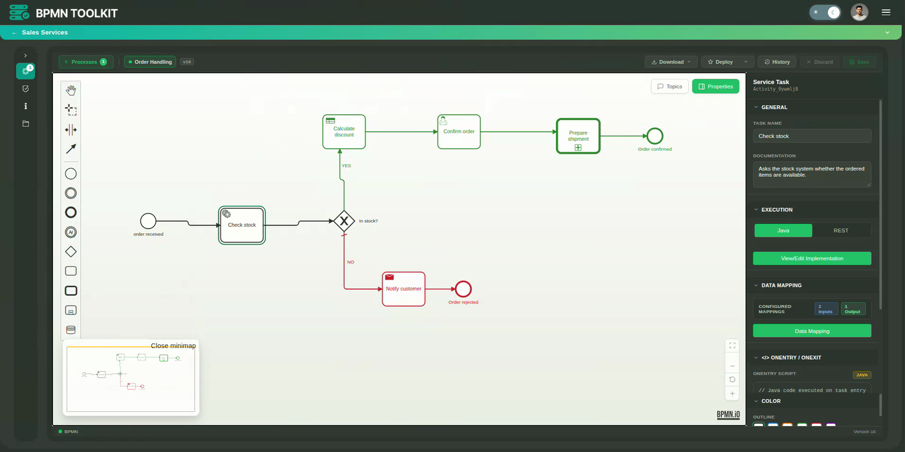
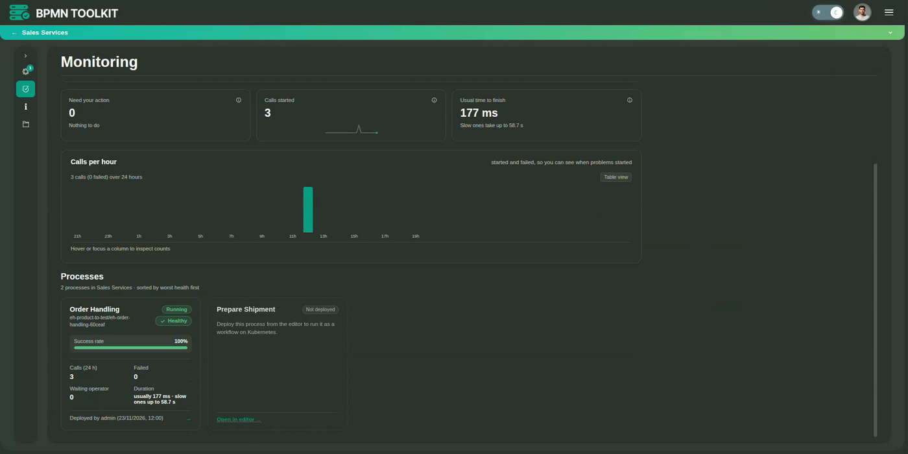
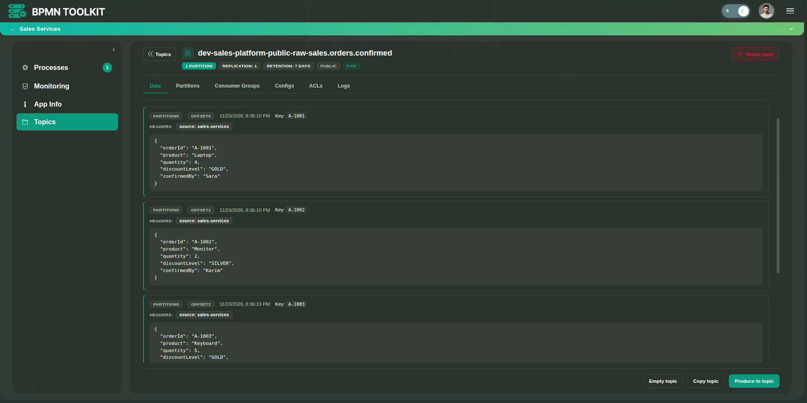

<div align="center">

# BPMN Toolkit

**Design, run and monitor your business processes on your own infrastructure.**

   


*A one-minute tour: design, deploy, test and monitor a sales process.*

**For a demo, send an email to [contact@dagitect.ch](mailto:contact@dagitect.ch).**

</div>

<table>
  <tr>
    <td width="33%"><br><sub><b>Design</b> a process in BPMN, with DMN rules and subprocesses.</sub></td>
    <td width="33%"><br><sub><b>Monitor</b> every call, its duration and the health of each workflow.</sub></td>
    <td width="33%"><br><sub><b>Connect</b> to Kafka: browse topics and read or send messages.</sub></td>
  </tr>
</table>

---

## What is BPMN Toolkit?

BPMN Toolkit is a single jar that turns business processes into running software. Your team draws a process in BPMN, writes its business rules as DMN decision tables, deploys it to your own Kubernetes cluster and watches it run. Nothing leaves your network.

## Contents

[Key features](#key-features) · [Quick start](#quick-start) · [Sign-in](#sign-in) · [Database](#database) · [License](#license)

---

## Key features

### 🎨 Design
- **BPMN editor:** processes with subprocesses and called processes, and a version kept at every save.
- **DMN decision tables:** business rules that analysts can read and edit.
- **Products and applications:** organise work by team, with members and permissions.
- **Export:** BPMN XML, Kogito BPMN, SVG and a PDF documentation.

### 🚀 Run
- **Deploy on Kubernetes:** one click turns a process into a workflow in your own cluster.
- **Test in the editor:** start an instance, complete its tasks and read the result.
- **Kafka:** manage topics, read and send messages, and pick topics on start and end events.

### 📈 Monitor
- **Every call, end to end:** the steps it took, where it waited and where it failed.
- **People tasks:** who has a task waiting, and for how long.
- **Email alerts:** limits per application or per process, per-team recipients and muting.
- **Operator actions:** retry or skip a failed step, abort a call, send rejected messages again.

### 🔐 Secure
- **Sign-in:** Microsoft Entra ID or local accounts, with roles and per-product members.
- **Your data:** SQLite or PostgreSQL, in your own environment.

---

## Quick start

1. Install **Java 21** or later (`java -version`).
2. Put `bpmn-toolkit-version.jar` in a folder of its own, with a `config/application.yml` beside it. Replace `version` with the number in your jar's name.
   ```yaml
   eventhub:
     security:
       jwt:
         secret: <random key: openssl rand -base64 48>
       bootstrap-admin:
         password: <strong password for the local admin>
   ```

3. Start it from that folder:

   ```bash
   java -jar bpmn-toolkit-version.jar
   ```

4. Open `http://localhost:8080` and sign in as `admin` with the password you set. You choose a new password at the first sign-in.

Your data is stored in `bpmn-toolkit.db` in that folder. To run it as a service for your team, or to sign in with Microsoft, read **Sign-in** below **before the first start**: the administrator password is read only once.

**Your address**, written `<your-address>` below, is the URL people type to open BPMN Toolkit. Use `http://localhost:8080` if it's only opened on the server itself. If people open it from other computers, use the `https://` address your IT provides, for example `https://bpmn.company.ch`. Microsoft sign-in does not accept `http://` for anything except localhost.

---

## Sign-in

<details>
<summary><b>Microsoft Entra ID</b></summary>

You need someone who can register applications in Microsoft Entra ID (Entra ID P1 to assign groups). The server and users' browsers must be able to reach `login.microsoftonline.com` on port 443.

#### Step 1: Microsoft Entra admin center

Your IT team does this. The secret stays with you.

1. **App registrations → New registration.** Name: BPMN Toolkit. Account types: *Accounts in this organizational directory only*.
2. **Redirect URI**, platform *Web*: `<your-address>/login/oauth2/code/entra`
3. **Certificates & secrets → New client secret.** Copy its *Value* and note the expiry date.
4. **App roles → Create app role.** Display name: BPMN Toolkit administrator. Value: `BpmnToolkit.Admin`. Allowed member types: Users/Groups.
5. **Enterprise applications → BPMN Toolkit:**
   - Properties: set **Assignment required** to Yes.
   - Users and groups: assign the administrators with the role `BpmnToolkit.Admin`, and assign the other employees who will use the tool.

If your tenant blocks user consent, also grant admin consent under **API permissions**.

**Being an Entra administrator is not enough.** A Global Administrator, for example, is only a BPMN Toolkit administrator if assigned the `BpmnToolkit.Admin` role.

Keep for Step 2: the **Directory (tenant) ID**, the **Application (client) ID** and the secret's **Value**.

#### Step 2: `config/application.yml`

Write this file **before the first start**:

```yaml
eventhub:
  security:
    jwt:
      secret: <random key: openssl rand -base64 48>
    bootstrap-admin:
      password: <strong password for the local admin>
    entra:
      enabled: true
      tenant-id: <Directory (tenant) ID>
      client-id: <Application (client) ID>
      client-secret: <secret Value>
      admin-app-role: BpmnToolkit.Admin
    sso:
      enabled: true
  public-url: <your-address>
```

Make this file readable by the service account only, since it holds the client secret.

With `sso` enabled, BPMN Toolkit goes through Microsoft automatically, and someone already signed in to Microsoft reaches the linked page with no login screen. Remove the `sso` lines to keep the normal sign-in page instead.

#### Step 3: Check before go-live

- [ ] `<your-address>/api/config` shows `"entra":true` and `"sso":true`.
- [ ] A holder of `BpmnToolkit.Admin` opens the address, goes through Microsoft automatically and sees the **Admin** menu.
- [ ] An employee without the role does not see the **Admin** menu.
- [ ] An employee not assigned to the app is stopped by Microsoft (error AADSTS50105).
- [ ] The local `admin` signs in at `<your-address>/?signin` and chooses a new password.

#### Who gets what

| Who | Result |
|---|---|
| Has the `BpmnToolkit.Admin` role | Administrator from the first sign-in, with the Admin menu |
| Role removed in Entra | Normal user from their next sign-in (an open session can last up to 12 hours) |
| Assigned to the app and added to a product | Normal user, no Admin menu |
| Assigned to the app, not added to a product yet | Refused until an administrator adds them: Admin → Products → a product → Members Permissions → Add Member |
| Outside your tenant | Refused |
| Local `admin` account | Administrator with its password at `/?signin`; keep it as the way in if Microsoft is unavailable |


</details>

<details>
<summary><b>Username and password</b></summary>

| | |
|---|---|
| Username | `admin` |
| Password | the one you set in `bootstrap-admin.password` |

With single sign-on on, the password form is at `<your-address>/?signin`.

The first time you sign in, you'll be asked to choose a new password. It needs at least 12 characters, with at least one letter and one digit.

After 5 wrong passwords in a row, sign-in is locked for 15 minutes.

The administrator adds other people from **Products → a product → Members Permissions → Add Member**.

To remove username and password sign-in, add this under `eventhub.security`. Nobody can then get in if Microsoft is down.

```yaml
    password-sign-in:
      enabled: false
```


</details>

---

## Database

<details>
<summary><b>SQLite (default)</b></summary>

Nothing to install or configure. On first start, BPMN Toolkit creates a file called `bpmn-toolkit.db` in the folder you started it from. That file holds all your data.

To back it up, stop the application, then copy the `.db` file.


</details>

<details>
<summary><b>PostgreSQL</b></summary>

1. You need a PostgreSQL database and a user who can create tables in it. If you don't have one, you can start one with Docker:

   ```bash
   docker run -d --name bpmn-postgres \
     -e POSTGRES_DB=eventhub \
     -e POSTGRES_USER=eventhub \
     -e POSTGRES_PASSWORD=change-me \
     -p 5432:5432 \
     -v bpmn-postgres:/var/lib/postgresql/data \
     postgres:17
   ```

2. Add your database settings to `config/application.yml`, under the same `eventhub:` as the settings above:

   ```yaml
   eventhub:
     database:
       type: postgresql
       postgresql:
         host: localhost
         port: 5432
         name: eventhub
         schema: public
         username: eventhub
         password: change-me
   ```

3. Start the jar from that folder as usual. The tables are created on first start.

You can also set these values with environment variables instead of the file: `EVENTHUB_DATABASE=postgresql`, `EVENTHUB_DB_HOST`, `EVENTHUB_DB_PORT`, `EVENTHUB_DB_NAME`, `EVENTHUB_DB_USERNAME` and `EVENTHUB_DB_PASSWORD`.

</details>

---

## License

### BPMN Toolkit

Copyright © 2026 Dagitect SARL. All rights reserved.

BPMN Toolkit is proprietary software. You may not copy, modify, distribute or resell it without written permission. To ask for permission, contact **contact@dagitect.ch**.

### Trademarks

BPMN™, Business Process Model and Notation™, DMN™ and Decision Model and Notation™ are trademarks of Object Management Group, Inc. BPMN Toolkit is not affiliated with, endorsed by or certified by OMG.

Microsoft and Microsoft Entra are trademarks of the Microsoft group of companies. PostgreSQL is a registered trademark of the PostgreSQL Community Association of Canada. Java is a registered trademark of Oracle and/or its affiliates. Docker is a registered trademark of Docker, Inc. Other names may be trademarks of their respective owners.

